<div align="center">


# Tremp 🚗 Rides solidarios a la Anáhuac Mayab

**Carpool universitario sin fines de lucro, exclusivo para la comunidad Anáhuac Mayab.**
Quien tiene auto comparte un trayecto que de todos modos iba a hacer; quien no tiene, llega a clases pagando solo su parte de la gasolina.


</div>

---

## 📑 Contenido

1. [El problema](#-el-problema)
2. [La solución](#-la-solución)
3. [Cómo funciona un viaje](#-cómo-funciona-un-viaje)
4. [Qué nos hace diferentes](#-qué-nos-hace-diferentes)
5. [Modelo económico: precio justo y sin lucro](#-modelo-económico-precio-justo-y-sin-lucro)
6. [Seguridad y privacidad](#-seguridad-y-privacidad)
7. [Impacto en el campus](#-impacto-en-el-campus)
8. [Escalabilidad](#-escalabilidad)
9. [Arquitectura](#️-arquitectura)
10. [API](#-api)
11. [Eventos](#-eventos)
12. [Estado del proyecto y hoja de ruta](#-estado-del-proyecto-y-hoja-de-ruta)
13. [Gobernanza y legal](#️-gobernanza-y-legal)
14. [Guía técnica (correr, desplegar y operar)](#️-guía-técnica)

---

## 🔥 El problema

Llegar a la Anáhuac Mayab todos los días no es igual de fácil para todos.

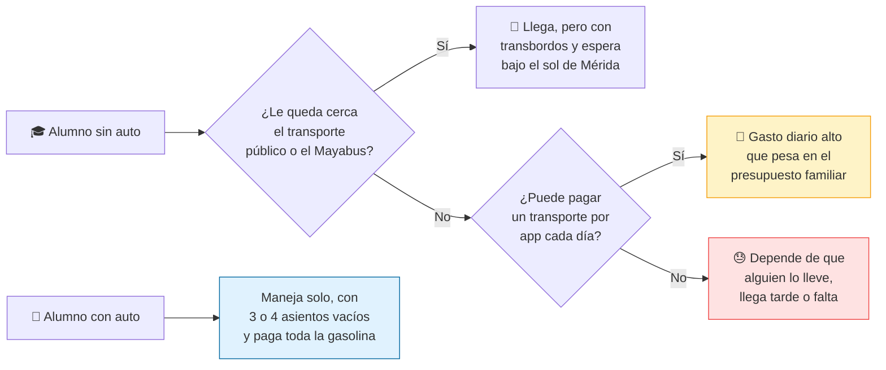

- **El campus está en la periferia norte de Mérida**, y las rutas de transporte público (Va y Ven) y del Mayabus no cubren todas las colonias donde viven los alumnos.
- **El clima** (calor y lluvias de temporada) hace que caminar a una parada y esperar sea un obstáculo real, no una incomodidad.
- **El transporte por app diario es caro** para muchos alumnos, sobre todo para becarios y foráneos.
- **Al mismo tiempo**, cientos de autos llegan cada mañana al mismo destino con asientos vacíos. Los coches y los alumnos que necesitan llegar ya están ahí; lo que falta es conectarlos de forma **segura y confiable**.
- **Los "rides" informales** (grupos de WhatsApp, conocidos) no verifican quién se sube, no tienen precio claro y dejan fuera a quien no tiene contactos.

## 💡 La solución

Tremp conecta a alumnos verificados que van hacia la universidad a la misma hora. El conductor no "trabaja" para la app: publica el trayecto que **ya iba a hacer**, ofrece hasta **3 lugares** y recibe solo una parte de la gasolina. El pasajero ve el precio final desde antes de pedir lugar.

<table>
  <tr>
    <td align="center">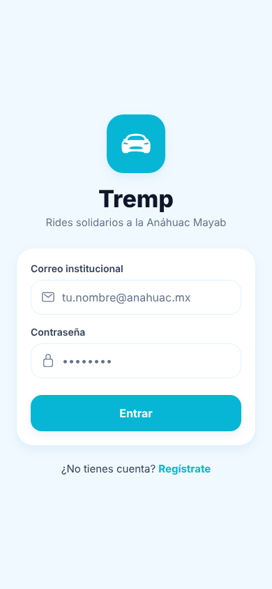<br/><sub><b>Solo correos @anahuac.mx</b></sub></td>
    <td align="center">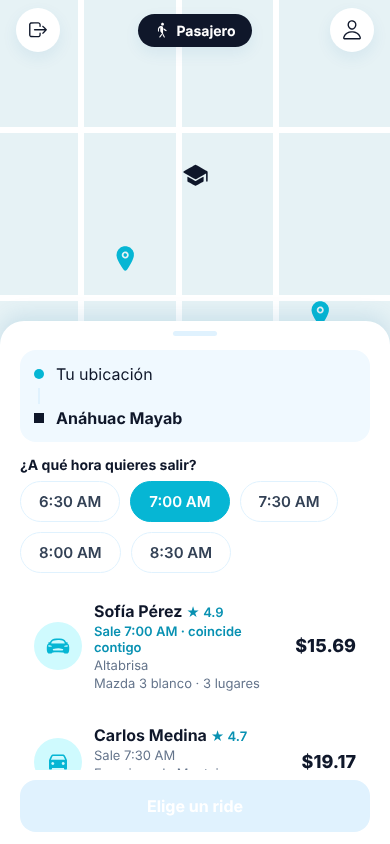<br/><sub><b>Pasajero:</b> elige hora y ve rides que coinciden</sub></td>
    <td align="center">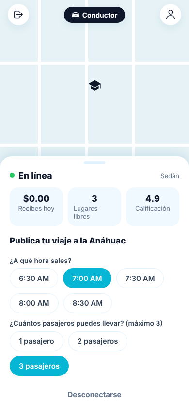<br/><sub><b>Conductor:</b> publica hora y lugares (máx. 3)</sub></td>
    <td align="center">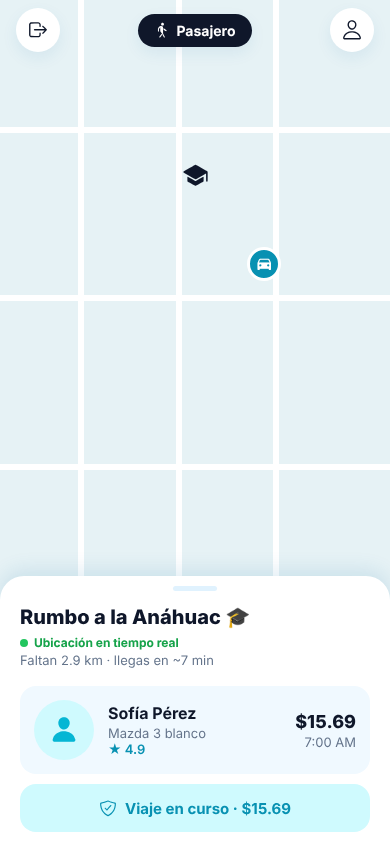<br/><sub><b>En vivo:</b> ubicación del conductor en el mapa</sub></td>
  </tr>
</table>

| Para el pasajero | Para el conductor | Para la universidad |
|---|---|---|
| Llega a clase por una fracción del costo de un transporte por app. | Recupera parte de su gasolina sin cambiar su rutina. | Menos autos con un solo ocupante y menos presión sobre el estacionamiento. |
| Viaja con compañeros verificados de su propia comunidad. | Decide hora y número de lugares; nadie le impone viajes. | Una herramienta concreta de inclusión y movilidad estudiantil. |
| Opción de ver **solo conductoras mujeres**, elegida en el registro. | El rol se define en el registro: con auto eres conductor. | Comunidad cerrada, con reglas claras y datos protegidos. |

## 🗺️ Cómo funciona un viaje

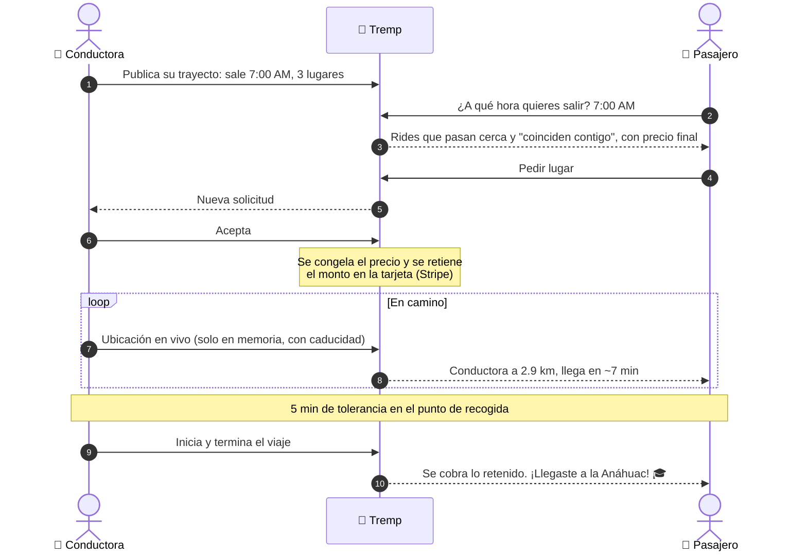

## ✨ Qué nos hace diferentes

Tremp **no es** un servicio de transporte por app ni busca serlo. Es una herramienta comunitaria para compartir un trayecto que ya existe.

| | 🚕 Transporte por app | 💬 Ride informal (WhatsApp) | 🚗 **Tremp** |
|---|---|---|---|
| ¿Quién maneja? | Conductor que trabaja para la plataforma | Un conocido | **Un compañero que ya iba a la universidad** |
| ¿Quién puede subir? | Cualquiera | Quien tenga contactos | **Solo comunidad Anáhuac verificada** |
| Precio | Tarifa comercial, dinámica por demanda | "Lo que sea", incómodo de pedir | **70% de la gasolina + $10 MXN, fijo y visible desde el inicio** |
| ¿Hay lucro? | Sí | No | **No: el conductor solo recupera gastos** |
| Preferencia de género | No | No | **"Solo conductoras mujeres" desde el registro** |
| Ubicación | Historial guardado | Se comparte a mano | **En vivo solo durante el viaje; nunca se guarda** |
| Pago | Tarjeta | Efectivo o transferencia | **Tarjeta vía Stripe; Tremp nunca ve el número** |

**Lo que lo hace defendible:**

1. **Confianza por diseño.** El acceso con `@anahuac.mx` se refuerza también en la base de datos, no solo en la app.
2. **Un precio que nadie puede inflar.** Distancia calculada en el servidor, rendimiento fijo por tipo de auto y precio oficial de la gasolina. No hay campos editables, propinas ni precios por demanda.
3. **Privacidad como principio.** La constitución técnica del proyecto prohíbe guardar coordenadas de forma permanente.
4. **Pensado para Mérida.** Horarios de entrada a clases (6:30 a 8:30 AM), destino fijo (el campus), paleta "fresca" pensada para el calor.

## 💰 Modelo económico: precio justo y sin lucro

El precio sale **siempre del servidor**. Nadie, ni conductor ni pasajero, puede editar la distancia, el rendimiento del auto ni el precio de la gasolina.

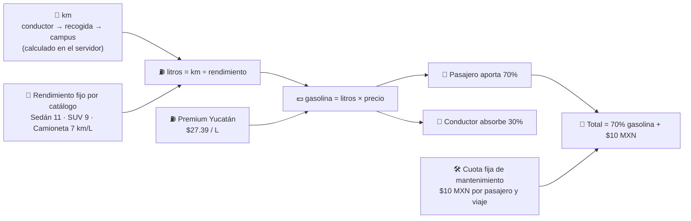

**Ejemplo real del cálculo** (17 km en sedán, issue #4 y spec 011):

| Concepto | Monto |
|---|---:|
| Gasolina del trayecto (17 km ÷ 11 km/L × $27.39) | $42.33 |
| Aporta el pasajero (70%) → **va íntegro al conductor** | $29.63 |
| Absorbe el conductor (30%) | $12.70 |
| Cuota de mantenimiento de la app | $10.00 |
| **Total que paga el pasajero** | **$39.63** |

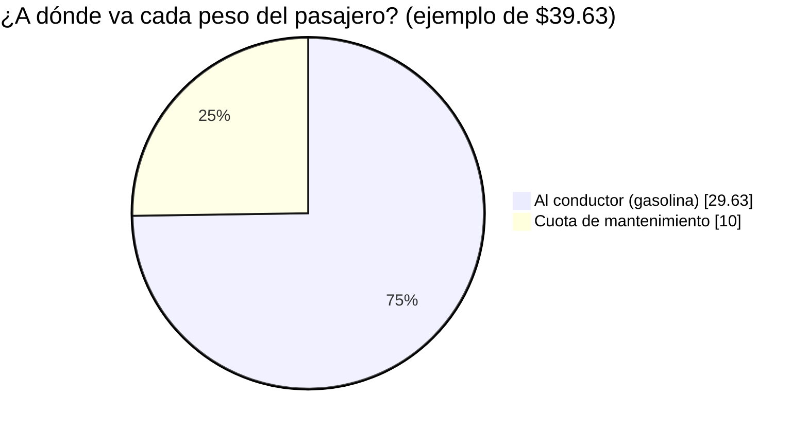

**Por qué es sostenible sin lucrar:** el conductor recupera solo gastos (nunca gana más de lo que gasta en gasolina), y la cuota de $10 cubre la comisión de Stripe (3.6% + $3 MXN + IVA, unos $5 en este ejemplo) y la operación de la app: servidores, soporte y seguridad. La cuota es una propuesta que todavía hay que validar con un presupuesto real (ver [Gobernanza](#️-gobernanza-y-legal)).

**Reglas de cancelación** (issue #4):

| Situación | Qué paga el pasajero |
|---|---|
| Cancela antes de que el conductor arranque | $0 |
| Cancela con el conductor en camino, o no llega en 5 min de tolerancia | 70% de la gasolina de los km ya recorridos, sin cuota |
| Cancela el conductor | $0 |

## 🔐 Seguridad y privacidad

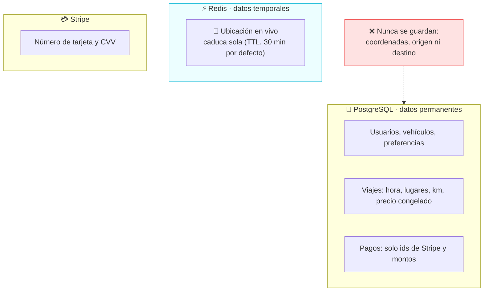

- **Comunidad cerrada:** solo correos `@anahuac.mx`, validados en la app, en la API y con un `CHECK` en la base de datos.
- **Sesión segura:** contraseñas con `scrypt`, sesión con JWT; búsqueda y pagos ya exigen token.
- **Ubicación efímera:** vive solo en Redis con caducidad y se borra al terminar el viaje. Postgres solo guarda magnitudes como `distancia_km`.
- **Privacidad entre usuarios:** el pasajero solo ve el tramo de la ruta entre su recogida y su bajada; nunca el origen ni el destino del conductor.
- **Pagos:** los datos de tarjeta van directo de la app a Stripe; el backend solo guarda identificadores.
- **Preferencia de género protegida:** "solo conductoras" (`solo_F`) se refuerza también con una regla en la base de datos.

## 🌱 Impacto en el campus

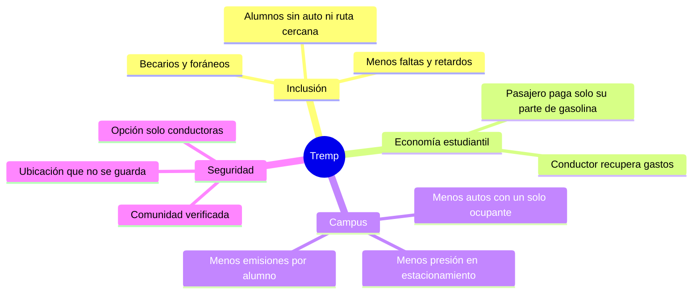

**Métricas que el piloto va a medir** (todavía no hay datos de uso real):

| Métrica | Qué nos dice |
|---|---|
| Lugares ocupados por viaje publicado | Si de verdad se llenan los asientos vacíos |
| Alumnos que llegan con Tremp por semana | Alcance real del servicio |
| Costo promedio por viaje del pasajero | Ahorro frente a otras opciones |
| Km compartidos y litros evitados | Impacto ambiental estimado |
| Viajes cancelados o no presentados | Confianza y calidad del servicio |

## 📈 Escalabilidad

Tremp nace en la Anáhuac Mayab, pero el problema (campus en la periferia, transporte público insuficiente y autos con asientos vacíos) se repite en casi todas las universidades privadas de México.

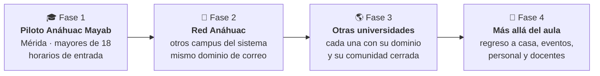

**Por qué la tecnología ya está lista para crecer:**

| Pieza | Cómo escala |
|---|---|
| API NestJS + Fastify | Sin estado: se agregan contenedores detrás del proxy sin cambiar código. |
| Redis Streams + consumer groups | Varias instancias procesan eventos en paralelo, con reintentos y cola de errores (DLQ). |
| Amazon EventBridge | Nuevos servicios (analítica, notificaciones, otra universidad) se suscriben sin tocar la API. |
| PostgreSQL (RDS) + PostGIS | Base administrada; las búsquedas por cercanía usan índices geográficos. |
| matching-py (OSRM + Bedrock) | Servicio aparte para emparejar rutas; escala por su cuenta. |
| Mapa MapLibre + OpenFreeMap | Sin API key ni costo por usuario. |
| Comunidad por dominio | Sumar una universidad es, en esencia, habilitar su dominio y su zona geográfica. |

**Lo que no escala solo:** cada estado tiene su propia ley de transporte, así que cada ciudad nueva requiere repetir la revisión legal. Ese costo está contemplado en la hoja de ruta.

## 🏗️ Arquitectura

Líneas continuas: funciona hoy. Líneas punteadas: planeado (specs 006 y 010).

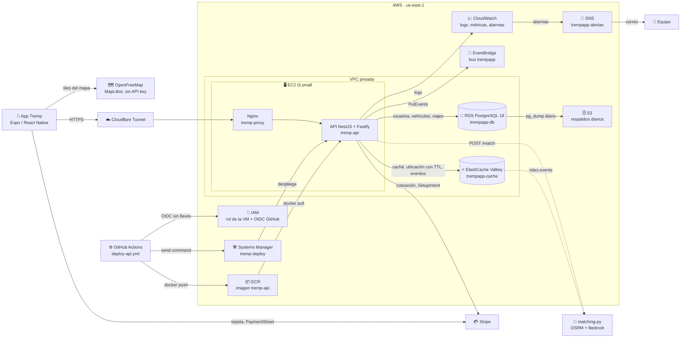

| Capa | Tecnología |
|---|---|
| App móvil | Expo (React Native), Expo Router, TypeScript, MapLibre GL + OpenFreeMap, `expo-location` |
| API | NestJS + Fastify, `class-validator`, JWT |
| Datos | PostgreSQL 18 (RDS) + PostGIS, Redis/Valkey (ElastiCache) |
| Eventos | Redis Streams (fuente de verdad), Pub/Sub para SSE, Amazon EventBridge |
| Rutas y matching | OSRM sobre OpenStreetMap, matching-py, Amazon Bedrock (preferencias en lenguaje natural) |
| Pagos | Stripe (SetupIntent, PaymentIntent con retención, Connect Express) |
| Operación | Docker, ECR, SSM, GitHub Actions con OIDC, CloudWatch + SNS, respaldos en S3 |
| Proceso | Spec-Driven Development: [`specs/constitution.md`](specs/constitution.md) y [`specs/README.md`](specs/README.md) |

## 🔌 API

Base URL: la URL pública del túnel (`https://<tunel>.trycloudflare.com`) o `http://localhost:3000` en local.
Errores con el formato estándar de NestJS (`{ statusCode, message, error }`), mensajes en español.

**Leyenda:** ✅ implementado · 🚧 especificado, en desarrollo · 🔒 requiere `Authorization: Bearer <token>`

### Autenticación ([spec 009](specs/009-auth/spec.md))

| | Método | Ruta | Body / query | Respuesta |
|---|---|---|---|---|
| ✅ | `POST` | `/auth/register` | `{ nombre, correo, password, sexo, prefSexoViaje?, vehiculo? }` | `201 { token, user }` · `400` · `409` correo duplicado |
| ✅ | `POST` | `/auth/login` | `{ correo, password }` | `200 { token, user }` · `401` |
| ✅ 🔒 | `GET` | `/auth/me` | | `200 user` · `401` |

### Usuarios, vehículos y preferencias ([005](specs/005-usuarios/spec.md), [008](specs/008-preferencias/spec.md))

| | Método | Ruta | Body / query | Respuesta |
|---|---|---|---|---|
| ✅ | `POST` | `/users` | Igual que `/auth/register` | `201 user` |
| ✅ | `GET` | `/users` | `?tipo=&verificado=&limit=&after=` | `200 { items, nextCursor }` |
| ✅ | `GET` · `PATCH` · `DELETE` | `/users/:id` | `PATCH { nombre?, fotoUrl? }` | `200` · `204` (baja en cascada) |
| ✅ | `PUT` · `DELETE` | `/users/:id/vehicle` | `{ categoria: sedan\|suv\|camioneta, capacidad, marca?, modelo? }` | Con vehículo es conductor; sin él, pasajero |
| ✅ | `GET` · `PATCH` | `/users/:id/preferences` | `{ prefSexoViaje, rawText }` | `200 { userId, prefSexoViaje, rawText, revision }` · `204` |

### Viajes y búsqueda ([006](specs/006-publicar-viaje/spec.md), [010](specs/010-busqueda-matching/spec.md))

| | Método | Ruta | Body / query | Respuesta |
|---|---|---|---|---|
| ✅ 🔒 | `POST` | `/rides/search` | `{ pickup:{lat,lng}, dropoff:{lat,lng}, departureAt, timeWindowMin?, limit? }` | `200 { results[] }` con conductor, hora, lugares, precio y tramo de ruta · `503` si matching-py no responde |
| 🚧 | `POST` | `/rides` | Conductor publica viaje; ruta calculada con OSRM | Devuelve la ruta para dibujarla · emite `ride.created` |
| 🚧 | | Ciclo del viaje | Unirse, aceptar, iniciar, finalizar, cancelar | Decisión abierta D3 de la spec 011 |

### Ubicación en vivo ([002](specs/002-database-privacidad/spec.md))

| | Método | Ruta | Body | Respuesta |
|---|---|---|---|---|
| ✅ | `PUT` | `/location/:userId` | `{ lat, lng, ttlSeconds? }` | `200 { lat, lng, actualizadaEn }`, guardado solo en Redis |
| ✅ | `GET` | `/location/:userId` | | `200` · `404` si caducó |
| ✅ | `DELETE` | `/location/:userId` | | `204` (dejar de compartir) |

### Pagos ([011](specs/011-pagos-stripe/spec.md))

| | Método | Ruta | Body / query | Respuesta |
|---|---|---|---|---|
| ✅ 🔒 | `GET` | `/payments/quote` | `?km=0.1–500&categoria=sedan\|suv\|camioneta` | `200 { km, rendimientoKmL, precioLitro, gasolina, pasajero, comision, total, conductor, moneda }` |
| ✅ 🔒 | `POST` | `/payments/setup-intent` | | Datos para el PaymentSheet de Stripe · `503` si Stripe está apagado |
| ✅ 🔒 | `GET` | `/payments/methods` | | `200 { items: [{ id, brand, last4, expMonth, expYear }] }` |
| 🚧 🔒 | `POST` | `/payments/connect/onboarding` | | `{ url }` para que el conductor dé de alta su cuenta Stripe Express |
| 🚧 🔒 | `GET` | `/payments/connect/status` | | `{ chargesEnabled, payoutsEnabled, detailsSubmitted }` |
| 🚧 | `POST` | `/payments/webhook` | Firma de Stripe | Maneja `payment_intent.*` y `account.updated` |

### Eventos, caché y salud ([001](specs/001-redis-events/spec.md))

| | Método | Ruta | Descripción |
|---|---|---|---|
| ✅ | `POST` | `/events` | Publica `{ type, payload, correlationId? }` → `202 { id, occurredAt }` |
| ✅ | `GET` | `/events?count=50` | Últimos eventos |
| ✅ | `GET` | `/events/dlq?count=50` | Eventos que fallaron todos sus reintentos |
| ✅ | `GET` | `/events/stream?types=a,b` | Server-Sent Events en tiempo real (requiere túnel con nombre) |
| ✅ | `PUT` · `GET` · `DELETE` | `/cache/:key` | Caché JSON con `ttl` opcional en segundos |
| ✅ | `GET` | `/health` | `{ status, redis, postgres }` con latencias · `503` si algo falla |

### Flujo: iniciar sesión y buscar un ride

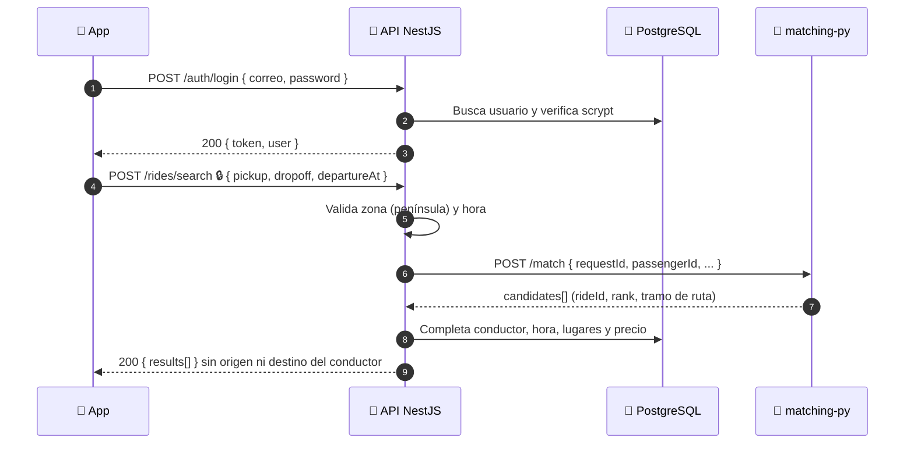

### Flujo: ubicación del conductor en vivo

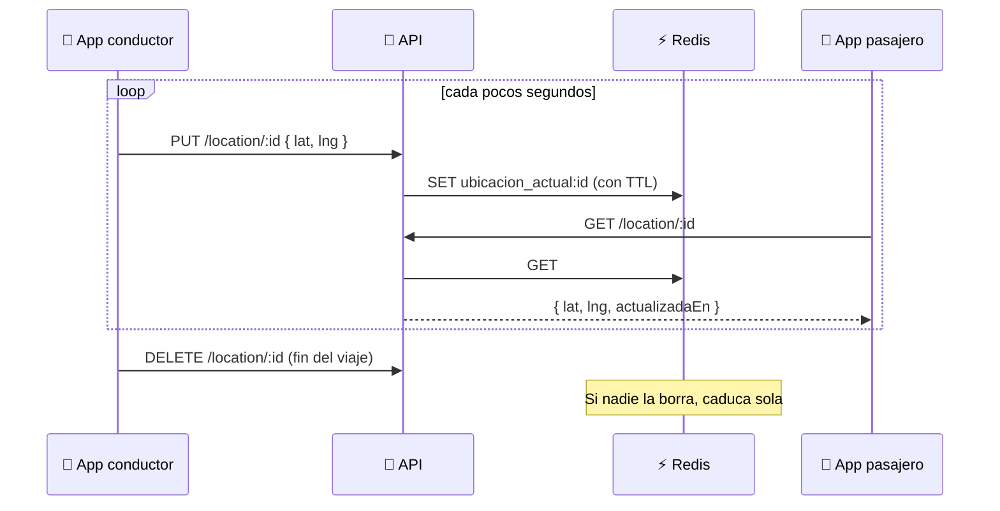

## 📨 Eventos

Toda acción de negocio deja un evento. **Redis Streams es la fuente de verdad** (entrega al menos una vez, con reintentos y DLQ), y un handler los reenvía a **Amazon EventBridge** para que otros servicios se suscriban sin tocar la API.

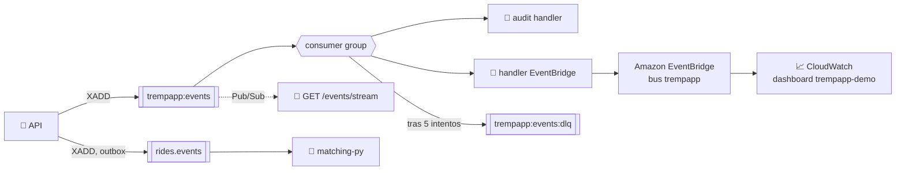

Formato del sobre en `trempapp:events`: `{ id, type, payload, occurredAt, correlationId? }`.
En EventBridge: `source = trempapp.backend`, `detail-type = type`, `detail = sobre completo`; los consumidores deduplican por `detail.id`.

### Catálogo de eventos

| Evento | Stream | Lo emite | Payload | Estado |
|---|---|---|---|---|
| `user.registered` | `trempapp:events` | Registro | `{ userId, tipoUsuario, vehiculo }` | ✅ |
| `user.updated` | `trempapp:events` | `PATCH /users/:id` | `{ userId, changed[] }` | ✅ |
| `user.deleted` | `trempapp:events` | `DELETE /users/:id` | `{ userId }` | ✅ |
| `vehicle.updated` | `trempapp:events` | `PUT /users/:id/vehicle` | `{ userId, vehiculo }` | ✅ |
| `vehicle.removed` | `trempapp:events` | `DELETE /users/:id/vehicle` | `{ userId }` | ✅ |
| `preferences.updated` | `rides.events` | `PATCH /users/:id/preferences` | `{ userId, revision, rawText }` (matching-py lo interpreta con Bedrock) | ✅ |
| `ride.created` | `rides.events` | `POST /rides` (outbox en la misma transacción) | `{ rideId, driverId, origin, destination, departureAt, seatsAvailable, maxDetourS, distanceM, durationS }` | 🚧 |
| `match.shown` | (matching-py) | Cada búsqueda | `requestId` y candidatos mostrados | 🚧 |
| `viaje.solicitado` · `viaje.aceptado` · `viaje.en_camino` · `viaje.llegada` · `viaje.esperando` · `viaje.iniciado` · `viaje.en_ruta` · `viaje.finalizado` · `viaje.cancelado` | `trempapp:events` | Hoy, el script de demo [`scripts/demo-simulacion.sh`](scripts/demo-simulacion.sh) vía `POST /events` | `{ viajeId, estado, km…, etaMin }` (nunca coordenadas) | 🚧 |
| `pago.retenido` · `pago.cobrado` · `pago.cancelado` · `pago.fallido` | `trempapp:events` | Ciclo de pago (spec 011, US8); hoy, el script de demo | Solo ids y montos en MXN | 🚧 |
| `conductor.pagos_actualizado` | `trempapp:events` | Webhook `account.updated` de Stripe | Estado de la cuenta Connect | 🚧 |

### Ciclo de vida de un viaje y su pago

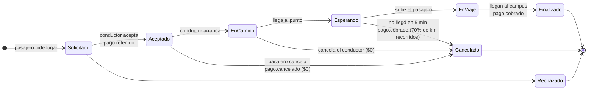

## 🧭 Estado del proyecto y hoja de ruta

Desarrollado con **Spec-Driven Development**: cada funcionalidad tiene su spec en [`specs/`](specs/README.md) con criterios de aceptación verificables y una [constitución](specs/constitution.md) de 17 principios.

| Spec | Qué | Estado |
|---|---|---|
| 001 | Base de eventos con Redis Streams, DLQ, SSE y caché | ✅ Implementado |
| 002 | Privacidad: ubicación solo en Redis con TTL | ✅ Implementado |
| 003 | Puente a Amazon EventBridge | ✅ Implementado |
| 004 | App móvil Expo (login, registro, home pasajero y conductor, mapa, viaje simulado) | 🚧 En desarrollo |
| 005 | Usuarios y catálogo de vehículos | ✅ Implementado |
| 006 | Publicar viaje con ruta OSRM y PostGIS | 🚧 En desarrollo |
| 007 | PostgreSQL | ✅ Implementado |
| 008 | Preferencias de viaje | ✅ Implementado |
| 009 | Autenticación con JWT | ✅ Implementado |
| 010 | Búsqueda de rides con matching-py | 🚧 En desarrollo |
| 011 | Pagos con Stripe | 🚧 Cotización y tarjetas listas; retención y cobro pendientes |

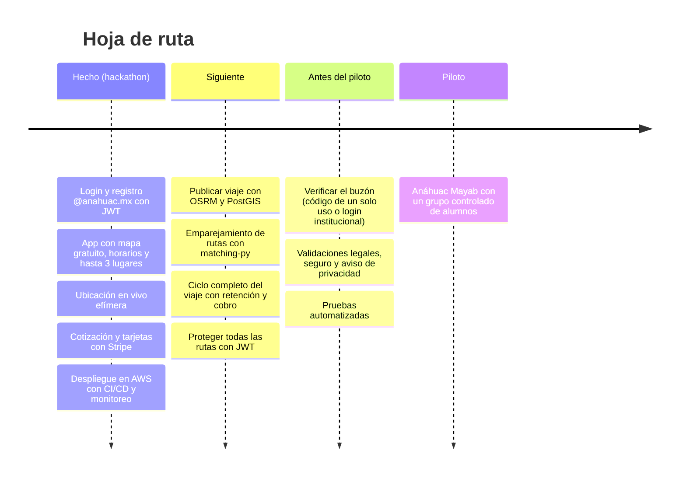

## ⚖️ Gobernanza y legal

> **Importante:** lo siguiente es una revisión documental del equipo al 24 de octubre de 2026. **No es asesoría legal ni una autorización para operar.** Ningún viaje con cobro real se hará antes de cerrar estos puntos.

**Definición propuesta:** plataforma comunitaria de viajes compartidos que conecta a integrantes verificados de la universidad con trayectos coincidentes, sin repartir utilidades y con una cuota de recuperación para sostener la aplicación.

| Tema | Qué falta | Estado |
|---|---|---|
| 🚦 Transporte en Yucatán | El art. 98 de la Ley de la Agencia de Transporte excluye ciertos traslados sin fines de lucro, pero los arts. 107 y 108 regulan a las empresas de redes de transporte. Pedir a la Agencia un **criterio escrito** con el flujo completo. | ⏳ Pendiente de validar |
| 🏛️ Responsable del proyecto | Quién contrata Stripe, recibe la cuota, administra los datos y atiende reclamaciones. Idealmente, un convenio con la universidad. | ⏳ Pendiente |
| 🛡️ Seguro | Confirmación escrita de la aseguradora sobre cobertura de ocupantes en viajes con aportaciones. | ⏳ Pendiente |
| 💳 Stripe | Confirmar que acepta el modelo; Connect para pagar a conductores; mostrar el precio total desde el inicio (LFPC). | ⏳ Pendiente de validar |
| 🔐 Acceso universitario | El dominio no basta: verificar control del buzón, campus Mayab, condición de alumno y mayoría de edad. | ⏳ Pendiente |
| 📄 Privacidad (LFPDPPP) | Aviso de privacidad con finalidades y derechos ARCO. La ubicación ya no se conserva (✅ en el diseño). | ⏳ Aviso pendiente |
| 🧾 Fiscal | Sin lucro no significa exento: contabilidad separada de aportaciones, cuota y comisiones, revisada por un contador. | ⏳ Pendiente |
| 🚨 Reglas y seguridad | Cancelaciones, reembolsos, soporte, protocolo de accidentes y acoso, revisión de licencia y vehículo de cada conductor. | ⏳ Pendiente |

Para llevar Tremp a otro estado hay que repetir la revisión de transporte con su ley local.

---

## 🛠️ Guía técnica


NestJS + Fastify + PostgreSQL (datos permanentes) + Redis (caché, Streams para eventos, Pub/Sub para SSE) + Amazon EventBridge (opcional). Desarrollado con
**Spec-Driven Development**: lee `specs/constitution.md` y el índice `specs/README.md` antes de cambiar nada.

### Arranque

```bash
cp .env.example .env
docker compose up -d redis postgres   # aplica db/schema.sql + db/seed.sql la 1ª vez
npm run start:dev          # o: npm run build && npm start
# todo en Docker:  docker compose up --build
```

App móvil contra el backend de la VM (Cloudflare): `./scripts/mobile-vm.sh https://<tunel>` (ver `mobile/README.md`).

### Base de datos

El esquema vive en `db/`. Para reiniciar la BD desde cero: `docker compose down -v && docker compose up -d postgres`.
Consola: `docker compose exec postgres psql -U trempapp`. `db/operaciones_comunidad.sql` son ejemplos para ejecutar a mano.

```ts
constructor(private readonly db: DatabaseService) {}

const users = await this.db.query<{ nombre: string }>('SELECT nombre FROM users WHERE tipo_usuario = $1', ['conductor']);
await this.db.transaction(async (client) => { /* client.query(...) */ });
```

### Amazon EventBridge

Con `EVENTBRIDGE_ENABLED=true` cada evento del stream se reenvía al bus `EVENTBRIDGE_BUS`
(`source = EVENTBRIDGE_SOURCE`, `detail-type = event.type`, `detail = { id, type, payload, ... }`).
Si el envío falla, el evento se reintenta y acaba en la DLQ como cualquier handler. Consumidores en AWS:
deduplicar por `detail.id`. Ver `specs/003-eventbridge/`.

```bash
aws cloudformation deploy --template-file infra/eventbridge.yaml --stack-name trempapp-eventbridge --capabilities CAPABILITY_NAMED_IAM

# adjunta la política publicadora (output PublisherPolicyArn) al rol de la VM
aws iam attach-role-policy --role-name <rol-de-la-vm> \
  --policy-arn $(aws cloudformation describe-stacks --stack-name trempapp-eventbridge \
    --query "Stacks[0].Outputs[?OutputKey=='PublisherPolicyArn'].OutputValue" --output text)
```

Credenciales: cadena por defecto del SDK (rol IAM en ECS/EC2, `AWS_PROFILE` en local). En la VM no hay keys:
el rol de la instancia da credenciales temporales, y la política solo permite `events:PutEvents` sobre el bus
con `source = EVENTBRIDGE_SOURCE`.

#### Probar EventBridge

```bash
aws events put-events --entries '[{"EventBusName":"trempapp","Source":"trempapp.backend","DetailType":"test.ping","Detail":"{\"hola\":\"mundo\"}"}]'
```

Debe responder `"FailedEntryCount": 0`. El bus no muestra el contenido por sí solo; para verlo en vivo, una regla de
depuración envía los eventos a CloudWatch Logs (borrar al terminar):

```bash
aws logs create-log-group --log-group-name /aws/events/trempapp-debug
aws logs put-retention-policy --log-group-name /aws/events/trempapp-debug --retention-in-days 1
aws logs put-resource-policy --policy-name EventBridgeToCWLogs-trempapp --policy-document '{"Version":"2012-10-17","Statement":[{"Effect":"Allow","Principal":{"Service":["events.amazonaws.com","delivery.logs.amazonaws.com"]},"Action":["logs:CreateLogStream","logs:PutLogEvents"],"Resource":"arn:aws:logs:<region>:<cuenta>:log-group:/aws/events/*:*"}]}'
aws events put-rule --name trempapp-debug --event-bus-name trempapp --event-pattern '{"source":["trempapp.backend"]}'
aws events put-targets --rule trempapp-debug --event-bus-name trempapp --targets "Id=logs,Arn=arn:aws:logs:<region>:<cuenta>:log-group:/aws/events/trempapp-debug"
aws logs filter-log-events --log-group-name /aws/events/trempapp-debug --query 'events[].message' --output text
```

### Despliegue en AWS (EC2 + ECR)

El backend se despliega como contenedor en una VM EC2 (Ubuntu 24.04, `t3.small`, disco cifrado, región `us-east-1`).
La app móvil (`mobile/`) no va en la VM: solo necesita la URL pública del backend.

- **Red:** el security group solo abre el 22 (SSH) desde la IP del dueño; `ufw` solo permite el 22. La API se
  publica en `127.0.0.1:3001`; delante, un Nginx (`tremp-proxy`) en `127.0.0.1:3000` registra cada petición, y el
  túnel de Cloudflare expone ese puerto (conexión de salida, sin puertos abiertos).
- **Bases administradas** (misma VPC que la VM, sin acceso público; sus security groups solo aceptan a la VM):
  - Postgres 18 en RDS `trempapp-db` (`db.t4g.micro`, 20 GB gp3 cifrado, respaldo automático de 1 día por el plan
    gratuito). `.env`: `DB_HOST=<endpoint de RDS>`, `PGSSLMODE=no-verify` (RDS exige SSL; `pg` lo lee solo).
  - Valkey en ElastiCache `trempapp-cache` (`cache.t4g.micro`, TLS + auth token). `.env`: `REDIS_HOST=<endpoint>`,
    `REDIS_PASSWORD=<auth token>`, `REDIS_TLS=true`.
  - Los contenedores `postgres` y `redis` de la VM quedaron detenidos (volúmenes `pg-data` y `redis-data`
    conservados) como plan B: para volver a ellos, `docker start postgres redis` y regresar los hosts del `.env`.
- **Respaldos de Postgres:** `tremp-backup.timer` (diario, 09:00 UTC) hace `pg_dump` de RDS a `/var/backups/trempapp`
  (últimos 7) y a `s3://trempapp-backups-196582131532/postgres/` (privado, cifrado, se borran a los 14 días).
  Restaurar: `gunzip -c <archivo> | tremp-psql`.
- **Consultar la base:** en la VM, `tremp-psql` (abre psql con los datos del `.env`). Desde la Mac con un cliente
  gráfico: `ssh -i ~/.ssh/aws-hack.pem -N -L 5433:<endpoint de RDS>:5432 ubuntu@<IP de la VM>` y conectar a
  `localhost:5433` (usuario `trempapp`, base `trempapp`, SSL requerido).
- **Rol de la VM:** lectura de ECR, `events:PutEvents` (política del stack de EventBridge), escribir en sus log groups
  y métricas `Trempapp`, y subir respaldos a S3. El hop limit del token IMDS es 2 para que el contenedor reciba las
  credenciales del rol.
- **Imagen:** la construye GitHub Actions y la sube a ECR `tremp-api` (ver abajo).
- **`.env`:** se crea en la VM a partir de `.env.example` (`chmod 600`, ya está en `.gitignore`); nunca se sube.

```bash
# En la VM
git clone https://github.com/Itsmasca/Tremp_Rides.git && cd Tremp_Rides
cp .env.example .env && chmod 600 .env        # editar DB_*, REDIS_*, EVENTBRIDGE_ENABLED=true

# primera imagen a mano; después la construye y sube GitHub Actions (ver abajo)
docker build -t <cuenta>.dkr.ecr.<region>.amazonaws.com/tremp-api:latest .
aws ecr get-login-password | docker login --username AWS --password-stdin <cuenta>.dkr.ecr.<region>.amazonaws.com
docker push <cuenta>.dkr.ecr.<region>.amazonaws.com/tremp-api:latest

docker network create tremp
docker run -d --name postgres --network tremp --restart unless-stopped \
  -e POSTGRES_USER=trempapp -e POSTGRES_PASSWORD=<clave> -e POSTGRES_DB=trempapp -v pg-data:/var/lib/postgresql/data \
  -v "$PWD/db/schema.sql:/docker-entrypoint-initdb.d/01-schema.sql:ro" \
  -v "$PWD/db/seed.sql:/docker-entrypoint-initdb.d/02-seed.sql:ro" postgres:17-alpine
docker run -d --name redis --network tremp --restart unless-stopped -v redis-data:/data \
  redis:7-alpine redis-server --requirepass <clave> --appendonly yes

# migraciones posteriores al esquema base (aplicar en orden)
docker exec -i postgres psql -v ON_ERROR_STOP=1 -U trempapp -d trempapp < db/002_add_preferences_columns.sql
docker exec -i postgres psql -v ON_ERROR_STOP=1 -U trempapp -d trempapp < db/003_vehiculo_catalogo.sql

docker run -d --name tremp-api --network tremp --restart unless-stopped --env-file .env \
  -p 127.0.0.1:3000:3000 <cuenta>.dkr.ecr.<region>.amazonaws.com/tremp-api:latest
```

#### URL pública (Cloudflare Tunnel)

`cloudflared` corre en la VM como servicio `systemd` (`cloudflared-quick`) y expone `127.0.0.1:3000` en una URL
`https://<algo>.trycloudflare.com`. Sin dominio es un *quick tunnel*: la URL cambia si se reinicia el servicio o la VM,
y no soporta Server-Sent Events (`/events/stream`). Para una URL fija y SSE hace falta un dominio en Cloudflare
(túnel con nombre).

```bash
# URL actual
sudo journalctl -u cloudflared-quick --no-pager | grep -o 'https://[a-z0-9-]*\.trycloudflare\.com' | tail -1
```

#### Despliegue automático (GitHub Actions)

`.github/workflows/deploy-api.yml`: cada push a `main` que toque el backend construye la imagen, la sube a ECR con
tag `<sha>` y `latest`, y ordena a la VM por SSM ejecutar `/usr/local/bin/tremp-deploy <sha>` (descarga la imagen,
recrea el contenedor `tremp-api` con el mismo `.env` y comprueba que la API responda; si no responde, vuelve a
levantar la imagen anterior). También se puede lanzar a mano desde la pestaña *Actions* (`workflow_dispatch`).

- GitHub entra a AWS por OIDC, sin keys: el rol `tremp-github-deploy` solo lo puede asumir este repo en `main`, y
  solo puede subir a `tremp-api` y mandar comandos a la VM.
- La VM tiene el agente SSM y la política `AmazonSSMManagedInstanceCore`; no se abren puertos para desplegar.
- Las migraciones de `db/` no se aplican solas: van a mano con `docker exec -i postgres psql ...` como arriba.

```bash
# Desplegar a mano desde la VM (mismo script que usa Actions)
sudo /usr/local/bin/tremp-deploy latest
```

#### Demo en vivo

`scripts/demo-simulacion.sh` simula un viaje completo con las cuentas demo `demo4@anahuac.mx` (conductora) y
`demo5@anahuac.mx` (pasajera): solicitud, aceptación con pago retenido, acercamiento al punto de recogida, 5 min de
tolerancia con cuenta regresiva, recorrido y cobro (70% de la gasolina + comisión de $10). Con `--no-llega` se agota
la tolerancia y se cancela cobrando el 70% de la gasolina ya manejada. La ubicación sólo va a Redis con TTL; los
eventos llevan km y minutos. Se ve en vivo en el dashboard `trempapp-demo` de CloudWatch (refresco de 10 s).

```bash
DEMO_PASSWORD=... ./scripts/demo-simulacion.sh https://<tunel>.trycloudflare.com [--rapido] [--no-llega]
```

#### Logs y alertas (CloudWatch)

`tremp-deploy` levanta la API con el driver `awslogs` (y `NO_COLOR=1`): los logs van al log group `/trempapp/api`
(7 días, un stream por contenedor) y `docker logs` sigue funcionando en la VM. El rol de la VM solo puede escribir en
ese log group y publicar métricas en el namespace `Trempapp`.

- Peticiones: `tremp-proxy` (Nginx, config en `/etc/tremp/nginx.conf` de la VM) escribe una línea JSON por petición
  (`method`, `path` sin query string, `status`, `rt` en segundos, `bytes`; sin IP ni bodies) en `/trempapp/requests`
  (7 días). Metric filters: `Requests` (sin `/health`), `Requests4xx`, `Requests5xx`, `RequestLatency`.
- `tremp-health.timer` (systemd, cada minuto) publica `Trempapp/ApiUp` = 1 si `/health` responde, 0 si no.
- Un metric filter cuenta las líneas `ERROR` del log group como `Trempapp/ApiErrors`.
- Alarmas: `trempapp-api-caida` (ApiUp < 1 durante 3 min o sin datos), `trempapp-api-5xx` (≥ 5 respuestas 5xx en
  5 min), `trempapp-api-errores` (≥ 5 errores en 5 min) y `trempapp-vm-status` (status check de EC2). Avisan por
  correo (al activarse y al volver a OK) por el tema SNS `trempapp-alertas`.
- Dashboard `trempapp` en CloudWatch: alarmas, peticiones por minuto, errores 4xx/5xx, tiempo de respuesta p50/p95,
  rutas más usadas, últimas peticiones, salud, CPU de la VM, eventos del bus y logs de la API.
- Decisión: el monitoreo es solo CloudWatch, sin OpenTelemetry.

```bash
aws logs tail /trempapp/api --follow
aws logs tail /trempapp/requests --follow
```

Pendiente: autenticación en los endpoints (hoy todos responden sin login) y el servicio `matching-py`.

### Añadir un handler

```ts
@Injectable()
export class OrdersHandler {
  @EventHandler('order.created', 'order.paid')
  async handle(event: EventEnvelope<{ orderId: number }>) {
    // idempotente: puede re-ejecutarse con el mismo event.id
  }
}
```

Regístralo como provider en cualquier módulo; el registry lo descubre solo.
Publicar desde código: `eventsService.publish('order.created', { orderId: 1 })`.
